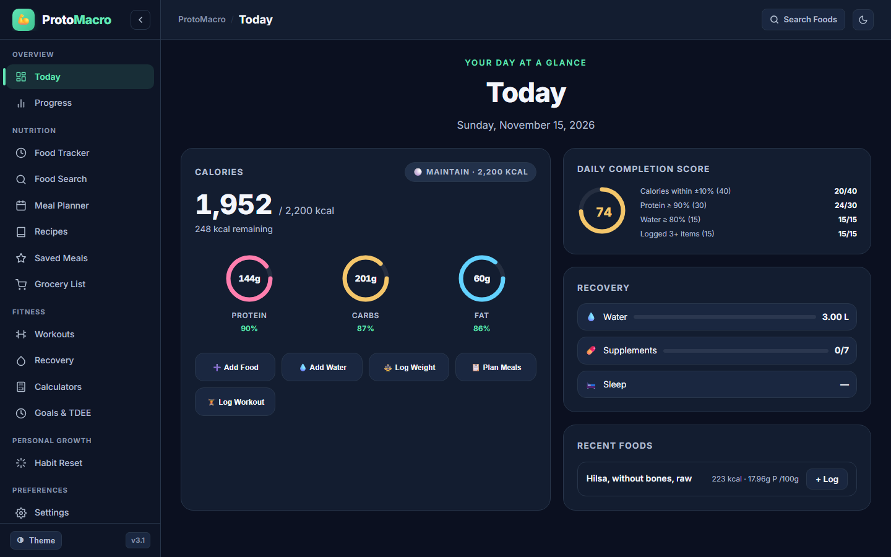
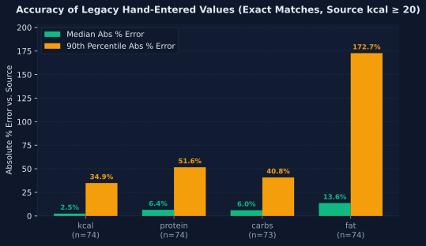
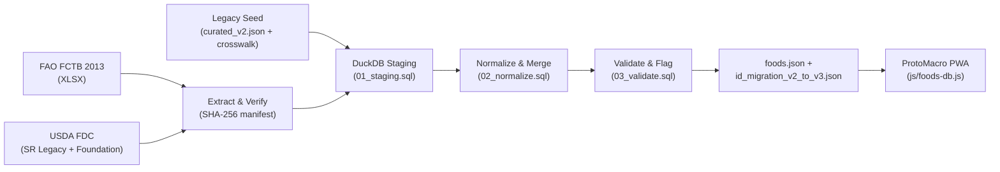
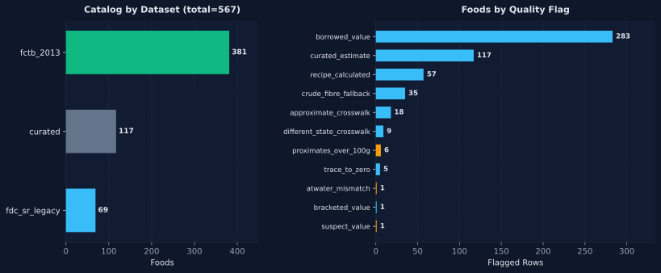
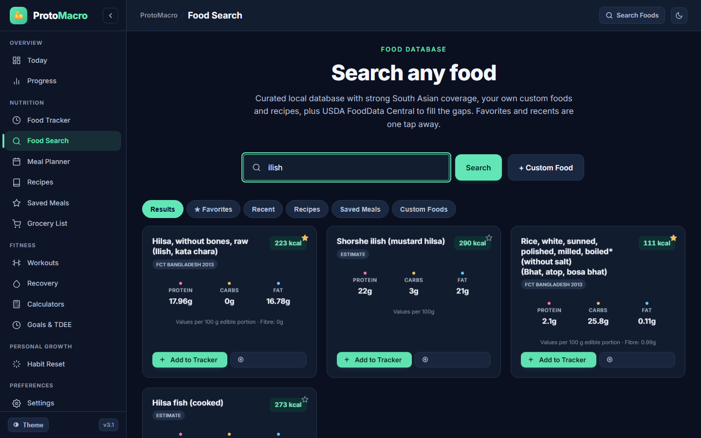
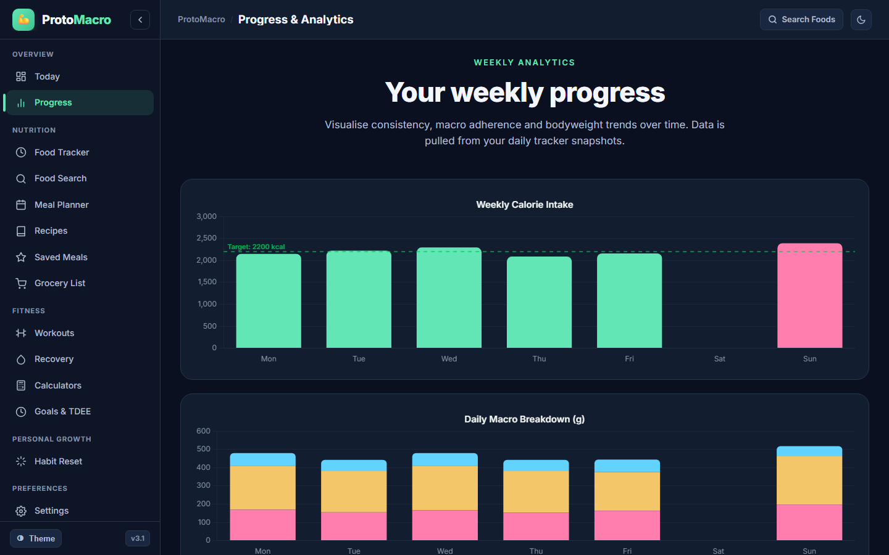
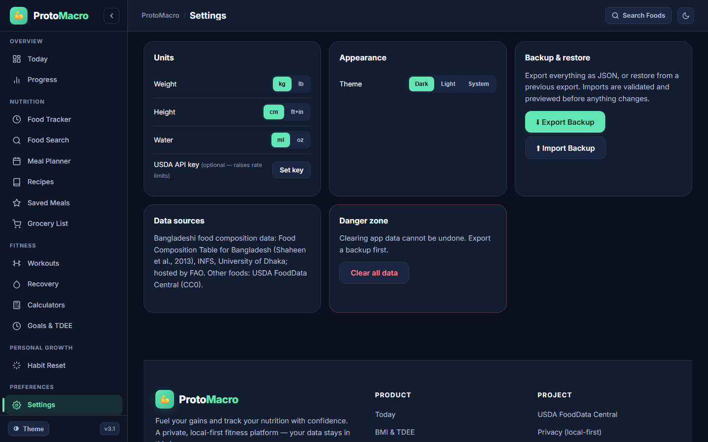
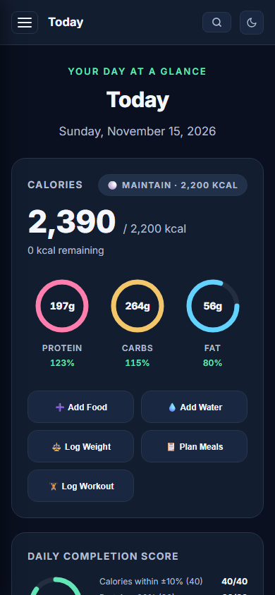

# ProtoMacro

Local-first nutrition & fitness PWA backed by a reproducible DuckDB food composition pipeline for Bangladeshi and international foods.

[](https://github.com/TahmidShafi/ProtoMacro/actions/workflows/pipeline.yml)
[](https://github.com/TahmidShafi/ProtoMacro/actions/workflows/deploy-pages.yml)

**Live Demo:** https://tahmidshafi.github.io/ProtoMacro/

### What I built
- **Sourced 567-food catalog via a tested DuckDB pipeline:** `381` foods from Bangladesh's FCTB 2013, `69` from USDA FDC SR Legacy, and `117` labelled estimates (provenance on every row, deterministic SHA-256 output).
- **Audit of legacy values + safe `v2 → v3` ID migration:** Measured hand-entered macro error against exact primary-source matches (`n = 74`) and migrated `local_0`..`local_193` across saved favorites, recents, planner, recipes, and saved meals without altering logged history.
- **Offline-first PWA with automated CI:** Vanilla JS + Workbox PWA verified by `104` Vitest unit tests, `8` pytest pipeline tests, and a `14`-route Playwright desktop/mobile UI audit.



---

## The Problem

Bangladeshi foods are thinly covered by the reference databases most trackers build on, and ProtoMacro's original list of 194 foods was hand-entered with no sources. Auditing those legacy entries against exact primary-source matches (`n = 74`, source `kcal >= 20`) showed a **median 2.5%** and **90th-percentile 34.9%** absolute calorie error (and **13.6% median / 172.7% 90th-percentile** fat error). These cover the 74 legacy foods with exact source matches; the 90 with no match remain labelled estimates. Replacing that static list with an automated DuckDB ETL pipeline grounds the catalog in primary national and USDA reference tables while migrating saved favorites, recents, planner, recipes and saved meals without changing any logged history.



---

## Data Pipeline



### Primary Sources

- **Food Composition Table for Bangladesh (FCTB 2013):** Shaheen, N., Rahim, A.T.M.A., Mohiduzzaman, M., Banu, C.P., Bari, M.L., Tukun, A.B., Mannan, M.A., Bhattacharjee, L. & Stadlmayr, B. (2013). *Food Composition Table for Bangladesh.* Institute of Nutrition and Food Science (INFS), Centre for Advanced Research in Sciences (CARS), University of Dhaka / FAO ([`FCDB_7_4_14.xlsx`](https://www.fao.org/fileadmin/templates/food_composition/documents/FCDB_7_4_14.xlsx), [`FCT_10_2_14_final_version.pdf`](https://www.fao.org/fileadmin/templates/food_composition/documents/FCT_10_2_14_final_version.pdf)).
- **USDA FoodData Central — SR Legacy (April 2018) & Foundation Foods (2026-10-29):** U.S. Department of Agriculture, Agricultural Research Service ([fdc.nal.usda.gov](https://fdc.nal.usda.gov/download-datasets), CC0 1.0).

### Key Engineering Decisions

| Decision | Why |
|---|---|
| **Exact-only replacement policy** | Only `match_type = exact` replaces legacy macros and migrates `local_N` to `fctb_*`/`fdc_*`. `approximate` and `different_state` items keep curated values (`curated_<slug>`) and link `related_ids` bidirectionally so wrong-dish or wrong-state macros are never silently substituted. |
| **`carbs_total` vs `carbs_available`** | FCTB reports available carbohydrate (`CHOAVLDF`, excluding fibre), whereas USDA FDC reports carbohydrate by difference (including fibre). Both fields are modeled explicitly with `fibre` exposed separately. |
| **Flag-don't-drop validation** | Non-fatal checks (`atwater_mismatch`, `proximates_over_100g`, `borrowed_value`, `crude_fibre_fallback`, `suspect_value`) annotate rows rather than silently dropping real foods; hard errors (negative macros, duplicate IDs, missing provenance) fail the build. |
| **Deterministic output** | Sorted SQL queries, `sort_keys=True` JSON serialization, and fixed-metadata SVG generation keep `foods_json_sha256` identical across runs and verifiable in CI via `git diff --exit-code js/data/`. |
| **Provenance on every row** | JSON Schema enforces `source.{dataset, code, version, citation_key}` and `basis` on all 567 catalog items (`additionalProperties: false`). |
| **Stable IDs + `v2 → v3` migration** | Positional `local_0`..`local_193` IDs in `favorites`, `recents`, `planner`, `recipes`, and `savedMeals` are rewritten deterministically via `id_migration_v2_to_v3.json` inside `normalizeState()`, leaving logged history untouched. |
| **`suspect_value` handling** | Known source anomalies (e.g., FCTB `08_0030` orange juice at 9 kcal / 97.7% water) are tracked in `pipeline/mappings/source_anomalies.csv` without mutating source numbers, ranked below unflagged results in search, and labeled `value disputed` with a reason tooltip. |
| **What the Atwater check proves** | In FCTB 2013, energy (`ENERC`) is itself derived from proximates via Atwater/INFOODS factors. A 0.35% median discrepancy validates parsing and internal consistency — not real-world laboratory accuracy. |

---

## Data Quality Summary

- **567 normalized foods:** `381` `fctb_2013`, `117` `curated`, `69` `fdc_sr_legacy`
- **Preparation states:** `260` `raw`, `202` `prepared`, `105` `cooked`
- **Legacy crosswalk (194 items):** `77` `exact`, `18` `approximate`, `9` `different_state`, `90` `none`
- **Atwater consistency:** `565` items checked (`Atwater > 0`), `0.35%` median error, `2.73%` 90th-percentile error, `1` flagged (`atwater_mismatch`)



Full report: [`pipeline/reports/data_quality.md`](pipeline/reports/data_quality.md)

---

## App Features

- **Today Dashboard:** Daily calorie/macro rings, completion score, quick-log actions, recovery summary, and recent foods.
- **Sourced Food Search:** Local instant search across 567 FCTB/USDA/curated items with source badges, Bengali/transliteration tags, `suspect_value` warnings, and optional live USDA FoodData Central lookup.
- **Food Tracker & Custom Foods:** Log meals by grams or servings, create custom foods, build multi-ingredient recipes, and save reusable meals.
- **Meal Planner & Grocery List:** Plan `breakfast`, `lunch`, `dinner`, and `snacks` meal slots and aggregate ingredients into a checkable grocery list.
- **Progress Analytics:** Weight trend, calorie/macro adherence, sleep, and workout volume charts powered by Chart.js.
- **Workouts, Recovery & Habits:** Log strength sessions, track water/supplements/sleep, and maintain daily habit streaks.
- **Goals, TDEE & Calculators:** Mifflin-St Jeor TDEE/BMI calculators with cut/maintain/bulk macro targets.
- **100% Local-First PWA:** Offline-ready via Workbox service worker, zero backend or account required, with JSON backup export/import and PDF report export.

| Food Search (`ilish`) | Progress Analytics |
|---|---|
|  |  |

| Settings & Data Sources | Mobile Today (390px) |
|---|---|
|  |  |

---

## Architecture & Stack

| Layer | Technology | Role |
|---|---|---|
| **Frontend** | Vanilla JS (ES modules) | Modular views, local state, schema migrations (`v1 → v2 → v3`) |
| **Build & PWA** | Vite 6 + `vite-plugin-pwa` (Workbox) | Asset bundling, font subsetting, offline precaching |
| **Visualizations** | Chart.js + jsPDF (lazy-loaded) | Client-side analytics charts and on-demand PDF export |
| **Data Pipeline** | Python 3.11+ + DuckDB + pandas + matplotlib | Extract, SHA-256 verification, SQL staging/normalization/validation, SVG charts |
| **Testing & QA** | Vitest + pytest + Playwright + ESLint | Unit, migration, pipeline, and cross-viewport UI verification |
| **CI / Hosting** | GitHub Actions + GitHub Pages | Automated pipeline tests, determinism check, static deployment |

---

## Testing & CI

- **Vitest (`npm test`):** `6` test files, `104` tests covering state normalization, `v2 → v3` ID migration, search ranking, calorie delta labels, meal planner solver, grocery aggregation, navigation, and workout/recovery logic.
- **pytest (`pytest pipeline/tests -v`):** `8` tests covering idempotent SHA-256 extraction, FCTB marker/energy parsing, `infer_state` rules, DuckDB validation errors/flags, `approximate` + `suspect_value` policy, fixture determinism, and JSON Schema / migration completeness.
- **Playwright UI Audit (`npm run audit:ui`):** Visits `14` desktop routes (`1440px`) and `14` mobile routes (`390px`) against `vite preview`, verifying `0` horizontal overflows, `0` console errors, and `0` page errors.
- **GitHub Actions:** [`pipeline.yml`](.github/workflows/pipeline.yml) runs `pytest` on PRs modifying `pipeline/**` or `js/data/**` and verifies deterministic regeneration on `workflow_dispatch`; [`deploy-pages.yml`](.github/workflows/deploy-pages.yml) builds and deploys `dist/` on `main`.

---

## Run Locally

### App (Node 20+)

```bash
npm ci
npm run dev          # local dev server
npm test             # 104 Vitest unit tests
npm run lint         # ESLint check
npm run build        # production build -> dist/
```

### Food Data Pipeline (Python 3.11+)

```bash
python -m venv pipeline/.venv
# Windows PowerShell:
pipeline\.venv\Scripts\Activate.ps1
# macOS / Linux:
# source pipeline/.venv/bin/activate

pip install -r pipeline/requirements.txt
pytest pipeline/tests -v
npm run data:build   # downloads sources (if missing), rebuilds js/data/, reports, and SVGs
```

---

## Limitations

- **FCTB vintage:** The primary Bangladeshi table (`FCTB 2013`) is from 2013; newer cultivar/packaged-food data are not covered.
- **Borrowed values:** `283` of `381` FCTB foods carry the `borrowed_value` flag (citing secondary/foreign composition tables in the FCTB bibliography).
- **Regional dish coverage:** Most Indian and Arab/Middle Eastern dishes lack exact matches in FCTB/FDC and remain `curated_estimate` entries.
- **Edible portion basis:** FCTB values are reported per `100 g edible portion` (bones, shells, and refuse excluded).
- **FCTB licensing ambiguity:** FAO/INFOODS lists FCTB 2013 as `"free access"` with no named open license (e.g., CC-BY or CC0); redistribution terms remain unconfirmed.

---

## Roadmap

1. Expand `curated_crosswalk.csv` and recipe-calculated dishes for remaining South Asian staples.
2. Surface `related_ids` (e.g., linking cooked curated dishes to raw FCTB entries) directly in the Food Search detail view.
3. Confirm FCTB redistribution licensing with INFS / FAO INFOODS.

---

## Data Attribution & License

> Bangladeshi food composition data: Food Composition Table for Bangladesh (Shaheen et al., 2013), INFS, University of Dhaka; hosted by FAO. Other foods: USDA FoodData Central (CC0).

The application and pipeline source code are licensed under the [MIT License](LICENSE). **The MIT License covers code only**; bundled food composition data remains subject to its respective sources' terms.

---

## Author

**Tahmid Jawad Shafi** — [GitHub](https://github.com/TahmidShafi) · [LinkedIn](https://www.linkedin.com/in/tahmid-jawad-shafi-70a271268/)
